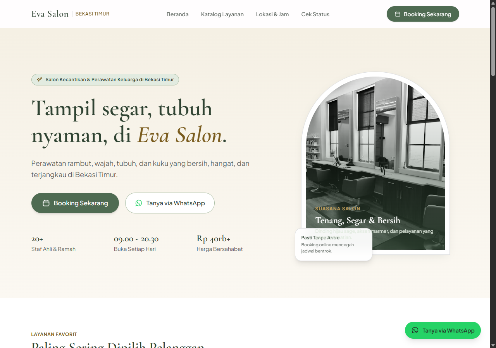
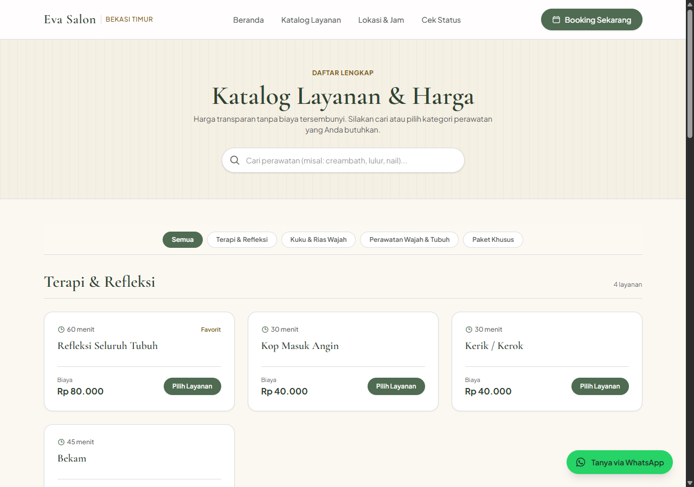
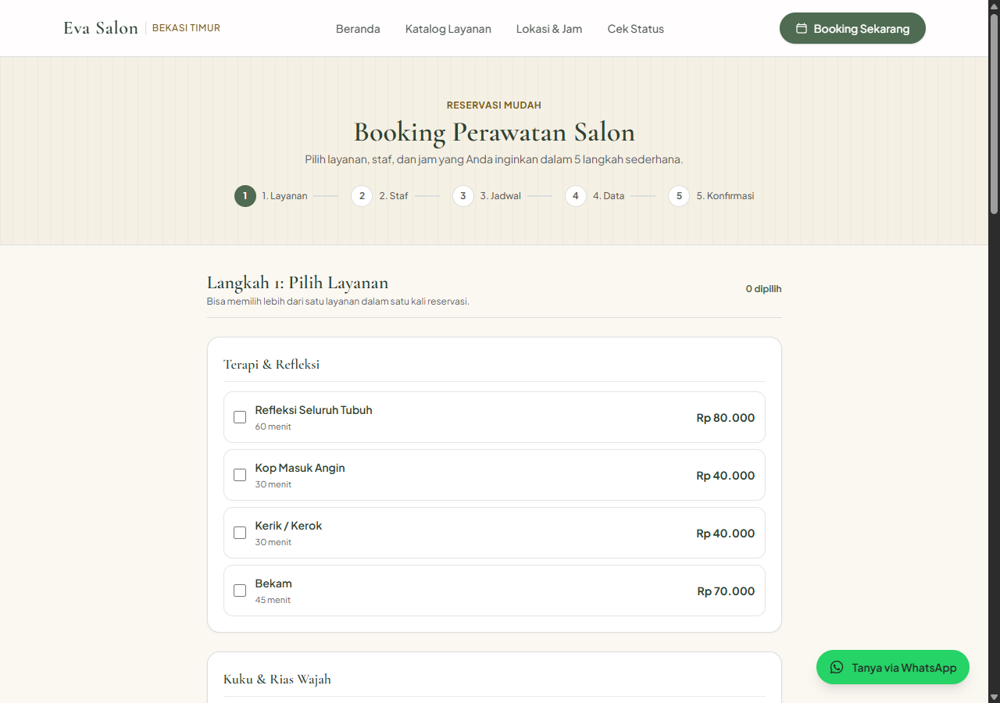
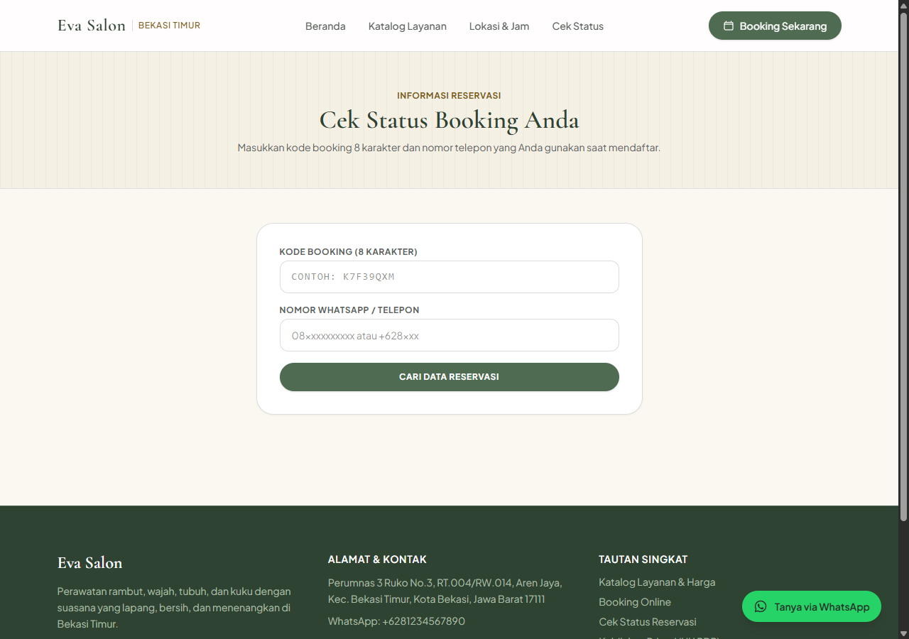
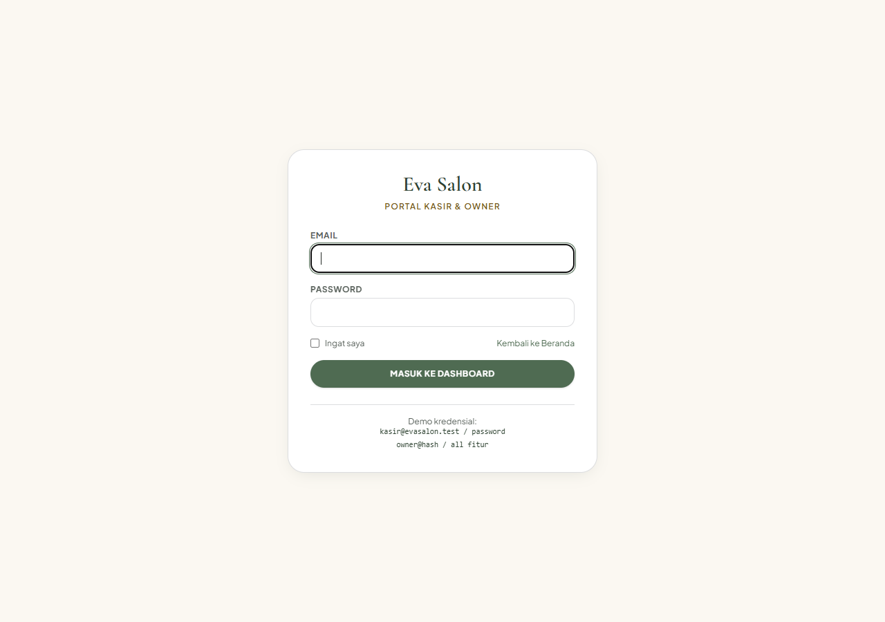
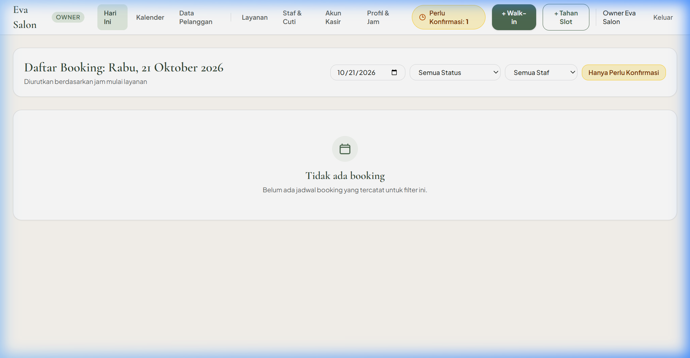

#  Eva Salon — Reservation & Salon Management System

Sistem manajemen reservasi dan operasional salon kecantikan terpadu yang dirancang untuk satu cabang salon skala menengah (~20 staf). Sistem ini menyediakan antarmuka publik untuk reservasi pelanggan secara mandiri, dashboard operasional kasir untuk jadwal harian dan *walk-in*, serta panel manajemen *owner* untuk staf, layanan, dan konfigurasi salon.


---

##  Tangkapan Layar (Screenshots)

Berikut adalah beberapa tampilan antarmuka utama dari Eva Salon:

### 1. Halaman Publik & Katalog Layanan
| Beranda Utama (Hero & Profil) | Katalog Layanan & Harga |
|:---:|:---:|
|  |  |

### 2. Alur Booking & Cek Status
| Reservasi Online 5 Langkah | Cek Status Booking Publik |
|:---:|:---:|
|  |  |

### 3. Panel Operasional Kasir & Owner
| Autentikasi Staf / Owner | Dashboard Jadwal Hari Ini |
|:---:|:---:|
|  |  |

---

##  Entity Relationship Diagram (ERD)

Sistem menggunakan database relasional MySQL 8 dengan desain tanpa *cascade delete* (`restrictOnDelete`) dan pencatatan riwayat *append-only*.

```mermaid
erDiagram
    USERS ||--o{ BOOKINGS : "created_by / confirmed_by"
    USERS ||--o{ BOOKING_STATUS_LOGS : "changed_by"
    USERS ||--o{ PAYMENTS : "recorded_by"
    USERS ||--o{ SCHEDULE_EXCEPTIONS : "created_by"

    CUSTOMERS ||--o{ BOOKINGS : "has"

    STAFF ||--o{ BOOKINGS : "assigned_to"
    STAFF ||--o{ STAFF_SCHEDULES : "has_weekly"
    STAFF ||--o{ SCHEDULE_EXCEPTIONS : "has_leave"
    STAFF }o--o{ SERVICES : "service_staff (N:M)"

    SERVICE_CATEGORIES ||--o{ SERVICES : "categorizes"

    BOOKINGS ||--|{ BOOKING_ITEMS : "contains"
    SERVICES ||--o{ BOOKING_ITEMS : "referenced_in"
    BOOKINGS ||--o{ BOOKING_STATUS_LOGS : "tracks"
    BOOKINGS ||--o{ PAYMENTS : "settled_via"

    SALON_PROFILES {
        bigint id PK
        string name
        text description
        text address
        string phone
        string wa_number
        text map_embed
        string operating_note
        smallint cancel_limit_minutes
        smallint hold_default_minutes
        smallint hold_max_minutes
        smallint pending_alert_hours
        boolean require_payment_to_complete
        timestamps timestamps
    }

    BUSINESS_HOURS {
        bigint id PK
        tinyint day_of_week UK "0=Minggu .. 6=Sabtu"
        time open_time
        time close_time
        boolean is_closed
        timestamps timestamps
    }

    USERS {
        bigint id PK
        string name
        string email UK
        string password
        enum role "owner, kasir"
        boolean is_active
        boolean must_change_password
        timestamps timestamps
    }

    CUSTOMERS {
        bigint id PK
        string name
        string phone UK "Format +62"
        string email
        timestamp consent_at "Persetujuan UU PDP"
        timestamp last_visit_at
        text notes
        timestamps timestamps
    }

    STAFF {
        bigint id PK
        string name
        string position
        string gender "female, male"
        string phone
        string photo_path
        boolean is_active
        smallint sort_order
        timestamps timestamps
    }

    STAFF_SCHEDULES {
        bigint id PK
        bigint staff_id FK
        tinyint day_of_week
        time start_time
        time end_time
        timestamps timestamps
    }

    SCHEDULE_EXCEPTIONS {
        bigint id PK
        bigint staff_id FK "nullable = seluruh salon"
        date starts_on
        date ends_on
        enum type "salon_closed, staff_leave"
        string note
        bigint created_by FK
        timestamps timestamps
    }

    SERVICE_CATEGORIES {
        bigint id PK
        string name
        smallint sort_order
        timestamps timestamps
    }

    SERVICES {
        bigint id PK
        bigint category_id FK
        string name
        text description
        integer price "Rupiah / Min price"
        integer price_max "Nullable untuk harga berentang"
        smallint duration_minutes
        smallint buffer_minutes
        string image_path
        boolean is_available
        boolean is_featured
        boolean is_sensitive "Layanan khusus wanita"
        smallint sort_order
        timestamps timestamps
    }

    SERVICE_STAFF {
        bigint service_id PK, FK
        bigint staff_id PK, FK
    }

    BOOKINGS {
        bigint id PK
        char booking_code UK "8 karakter acak non-ambigu"
        bigint customer_id FK "nullable"
        string customer_name "Snapshot nama"
        string customer_phone "Snapshot telepon"
        bigint staff_id FK
        datetime start_at "UTC"
        datetime end_at "Selesai layanan"
        datetime blocked_until "end_at + buffer"
        enum status "hold, pending, confirmed, completed, cancelled, no_show"
        enum source "online, walk_in, phone_hold"
        datetime hold_until "Batas kedaluwarsa hold"
        integer total_price
        smallint total_duration
        text notes
        bigint created_by FK
        bigint confirmed_by FK
        timestamp consent_at
        timestamps timestamps
    }

    BOOKING_ITEMS {
        bigint id PK
        bigint booking_id FK
        bigint service_id FK
        string service_name "Snapshot nama layanan"
        integer price_snapshot "Snapshot harga per item"
        smallint duration_snapshot "Snapshot durasi"
        smallint buffer_snapshot "Snapshot buffer"
        tinyint sequence "Urutan pengerjaan"
        timestamps timestamps
    }

    BOOKING_STATUS_LOGS {
        bigint id PK
        bigint booking_id FK
        enum from_status
        enum to_status
        enum actor_type "customer, kasir, owner, system"
        bigint changed_by FK
        string reason "Wajib untuk cancel dan no_show"
        timestamp created_at "Append-only"
    }

    PAYMENTS {
        bigint id PK
        bigint booking_id FK
        integer amount "Bisa bernilai negatif untuk koreksi"
        enum method "cash, transfer, qris"
        enum kind "payment, correction"
        datetime paid_at
        bigint recorded_by FK
        string note
        timestamp created_at "Append-only"
    }

    GALLERY_IMAGES {
        bigint id PK
        string path
        string caption
        smallint sort_order
        timestamps timestamps
    }
```



---

##  Fitur Utama

### 1. Area Publik (Pelanggan)
- **Katalog Layanan Transparan**: Menampilkan harga resmi, durasi pengerjaan, estimasi rentang harga (untuk *make up*, *eyelash*, dll.), serta filter kategori (*Terapi & Refleksi*, *Kuku & Rias Wajah*, *Perawatan Wajah & Tubuh*, dan *Paket Khusus*).
- **Reservasi Online 5 Langkah Tanpa Wajib Akun**:
  1. **Pilih Layanan**: Mendukung pemilihan multi-layanan dalam satu kali kunjungan.
  2. **Pilih Staf**: Pelanggan dapat memilih terapis/kapster favorit atau memilih opsi *"Siapa saja"* (sistem akan mencocokkan staf yang memenuhi kualifikasi secara otomatis).
  3. **Pilih Tanggal & Jam**: Menghitung ketersediaan slot kosong secara *real-time* berdasarkan jadwal kerja staf, buffer jeda, dan reservasi yang ada.
  4. **Data Pelanggan & Persetujuan Privasi**: Pengisian nama, nomor telepon WhatsApp, catatan khusus, dan persetujuan UU PDP (`consent_at`).
  5. **Konfirmasi Reservasi**: Penerbitan Kode Booking unik 8 karakter yang dapat disimpan oleh pelanggan.
- **Cek Status Reservasi Publik**: Pelanggan dapat mengecek jadwal dan status booking menggunakan kombinasi **Kode Booking** dan **Nomor WhatsApp**.
- **Pembatalan Mandiri**: Pelanggan dapat membatalkan booking berstatus `pending` atau `confirmed` secara mandiri hingga batas toleransi salon (default 30 menit sebelum jadwal).
- **Integrasi Tombol WhatsApp (`wa.me`)**: Tautan langsung ke WhatsApp salon dengan teks pesan otomatis berisi rincian jadwal reservasi.

### 2. Panel Kasir (Front-Desk Operasional)
- **Dashboard Hari Ini**: Tampilan jadwal harian staf, status antrean (*Pending*, *Confirmed*, *In-Service*, *Completed*, *Cancelled*, *No-Show*).
- **Pencatatan Walk-In Cepat**: Form pembuatan booking langsung untuk pelanggan yang datang ke lokasi dengan alur ringkas (selesai dalam hitungan detik).
- **Penahanan Slot Telepon (*Hold*)**: Fitur untuk pelanggan yang menelepon untuk menahan slot sementara dengan *timer* otomatis (`hold_until`) tanpa membuat slot terkunci permanen jika tidak dikonfirmasi.
- **Konfirmasi & Transisi Status**: Mengubah status reservasi dengan verifikasi identitas serta pencatatan alasan wajib saat pembatalan atau no-show.
- **Pencatatan Pembayaran**: Dukungan multi-metode bayar (*Cash*, *Transfer*, *QRIS*) dengan toleransi koreksi nominal.
- **Perlindungan Privasi Layar Kasir**: Opsi menyembunyikan catatan privasi pelanggan saat layar kasir terlihat oleh pengunjung salon.

### 3. Panel Owner (Manajemen & Pengaturan Salon)
- **Manajemen Layanan & Kategori**: Tambah/edit layanan, pengaturan harga minimum dan maksimum (berentang), durasi pengerjaan, jeda istirahat/pembersihan (*buffer time*), dan penandaan layanan sensitif khusus staf wanita.
- **Manajemen Staf & Jadwal Kerja**: Pengaturan profil staf, nomor kontak, foto, alokasi layanan yang dikuasai, shift harian per hari dalam seminggu, dan manajemen cuti staf atau libur operasional salon.
- **Manajemen Akun Kasir**: Tambah akun staf kasir dengan pembuatan kata sandi sementara acak dan kewajiban ganti password (`must_change_password`).
- **Pengaturan Profil Salon**: Konfigurasi nama, nomor WhatsApp resmi, alamat, Google Maps embed, catatan jam kerja, serta parameter aturan bisnis (durasi hold, batas menit pembatalan, toleransi peringatan booking pending).
- **Galeri Foto Salon**: Unggah dan atur foto suasana salon dengan kompresi WebP otomatis.

---

##  Panduan Setup & Instalasi Lokal

### Kebutuhan Sistem
- **PHP**: Versi `^8.3` atau `^8.4` (disarankan 8.4) dengan ekstensi `pdo_mysql`, `gd`, `mbstring`, `fileinfo`, `openssl`.
- **Composer**: Versi 2.x
- **Node.js**: Versi 18.x atau 20.x & npm
- **Database**: MySQL 8.0+ atau MariaDB 10.4+

### Langkah-Langkah Instalasi

1. **Clone Repository**:
   ```bash
   git clone https://github.com/fathurrahmanrifaldi/eva-salon.git
   cd eva_salon
   ```

2. **Install Dependensi PHP**:
   ```bash
   composer install
   ```

3. **Salin Environment & Generate App Key**:
   ```bash
   cp .env.example .env
   php artisan key:generate
   ```

4. **Konfigurasi Database di `.env`**:
   Buka file `.env` dan sesuaikan kredensial database lokal Anda:
   ```env
   DB_CONNECTION=mysql
   DB_HOST=127.0.0.1
   DB_PORT=3306
   DB_DATABASE=eva_salon
   DB_USERNAME=root
   DB_PASSWORD=
   ```

5. **Jalankan Migrasi & Data Seeder**:
   ```bash
   php artisan migrate --seed
   ```
   *Seeder ini otomatis membuat profil salon, jam kerja 7 hari (09.00 - 20.30 WIB), 4 kategori layanan, daftar layanan lengkap, 4 staf awal dengan jadwal mingguan, dan 2 akun pengguna (Owner & Kasir).*

6. **Install Dependensi Frontend & Build Aset**:
   ```bash
   npm install --ignore-scripts
   npm run build
   # Atau untuk development: npm run dev
   ```

7. **Tautkan Storage (Storage Symlink)**:
   ```bash
   php artisan storage:link
   ```

8. **Jalankan Local Development Server**:
   ```bash
   php artisan serve --port=8000
   ```
   Buka browser di `http://127.0.0.1:8000`.

---

##  Kredensial Akun Default (Seeder)

Setelah menjalankan `php artisan db:seed`, Anda dapat masuk menggunakan akun uji coba berikut:

| Peran (Role) | Email | Password | Akses URL |
|---|---|---|---|
| **Owner** | `owner@evasalon.test` | `murahmeriah` | `http://127.0.0.1:8000/login` |
| **Kasir** | `kasir@evasalon.test` | `password` | `http://127.0.0.1:8000/login` |

---

##  Keputusan Teknis Penting

Berikut adalah pertimbangan arsitektur dan keputusan rekayasa teknis yang diterapkan dalam aplikasi ini:

### 1. Pencegahan Double-Booking & Race Condition
- **Tantangan**: Dalam salon kecantikan dengan banyak staf dan durasi layanan berbeda, race condition terjadi ketika dua pelanggan memilih slot staf yang sama di detik yang bersamaan.
- **Solusi**: Pengecekan slot tidak hanya dilakukan di UI/frontend. Semua reservasi dan hold slot dieksekusi melalui satu method pusat (`BookingService::reserveSlot`) di dalam transaksi database dengan *pessimistic lock*:
  ```php
  Staff::whereKey($staffId)->lockForUpdate()->firstOrFail();
  ```
- **Kondisi Overlap Presisi**: Dua rentang waktu dianggap bertabrakan jika:
  ```sql
  start_at < new_blocked_until AND blocked_until > new_start_at
  ```
  Kondisi ini terbukti benar untuk semua skenario (tabrakan sebagian, overlap penuh di dalam, atau mencakup rentang).

### 2. Konsep Dua Dimensi Waktu: `end_at` vs `blocked_until`
- Setiap booking memiliki `end_at` (waktu selesainya perawatan) dan `blocked_until` (`end_at` + `buffer_minutes`).
- *Buffer time* (10–15 menit) memberikan jeda bagi staf untuk sterilisasi alat, cuci tangan, atau persiapan ruangan sebelum pelanggan berikutnya tiba.
- Pengecekan ketersediaan slot mengunci rentang waktu hingga `blocked_until`, sehingga slot staf berikutnya tidak akan pernah mepet tanpa jeda istirahat/persiapan.

### 3. Slot Hold Tanpa Ketergantungan Background Cron
- **Tantangan**: Banyak shared hosting (seperti cPanel Mini Plus) tidak mengizinkan cron job interval per menit atau queue worker daemon.
- **Solusi**: Slot yang ditahan via telepon disimpan di tabel `bookings` dengan status `hold` dan batas waktu `hold_until`. Query ketersediaan slot memperlakukan hold sebagai tidak aktif jika `hold_until < now()`:
  ```php
  $q->where('status', 'hold')->where('hold_until', '>', now());
  ```
  Dengan pola ini, slot otomatis terlepas secara instan begitu melewati waktu kedaluwarsa tanpa perlu worker atau cron job pembersih.

### 4. Immutabilitas Snapshot & Larangan Hard Delete
- **Snapshot Finansial**: Layanan dapat mengalami perubahan harga atau durasi di kemudian hari. Oleh karena itu, harga, durasi, buffer, dan nama layanan disalin permanen ke `booking_items` saat transaksi terjadi.
- **Audit Trail**:
  - Tabel `booking_status_logs` bersifat *append-only* (tanpa `updated_at`) untuk merekam riwayat perpindahan status, waktu, alasan pembatalan/no-show, dan identitas pelaku (*actor*).
  - Tabel `payments` tidak mendukung hapus data. Kesalahan input diselesaikan melalui baris pencatatan baru bertipe `correction` dengan nominal penyesuaian (bisa bernilai negatif).
- **Proteksi Foreign Key**: Seluruh relasi database menggunakan `restrictOnDelete()` untuk mencegah penghapusan data master yang sudah memiliki riwayat transaksi.

### 5. Standardisasi Zona Waktu
- Semua waktu dan tanggal disimpan di MySQL dalam format **UTC**.
- Waktu hanya dikonversi ke zona waktu lokal (`Asia/Jakarta` / WIB) pada lapisan tampilan (*presentation layer*) melalui helper terpusat `app/Support/Tz.php`.

### 6. Perlindungan Privasi (UU PDP) & Keamanan Data
- Reservasi online mewajibkan centang persetujuan pemrosesan data pribadi (`consent_at`).
- Halaman cek status publik menerapkan proteksi berlapis:
  1. Wajib mencocokkan dua faktor: **Kode Booking** (8 digit tanpa karakter ambigu `0`, `O`, `1`, `I`) dan **Nomor Telepon**.
  2. Dilindungi *rate limiter* sebanyak 10 percobaan per menit per IP (`throttle:10,1`).
  3. Mengembalikan pesan error generik saat tidak ditemukan guna mencegah enumerasi data reservasi pelanggan lain.

### 7. Optimasi File Upload & Performa Aset
- Gambar yang diunggah divalidasi MIME dan ukuran maksimal (2 MB).
- Menggunakan ekstensi GD untuk meresize foto maksimal lebar 1200 px dan mengonversinya langsung ke format **WebP** guna menghemat kuota penyimpanan hosting dan mempercepat *first contentful paint* (FCP).
- Font lokal (*self-hosted* format `.woff2`) untuk Playfair Display/Cormorant Garamond dan Plus Jakarta Sans guna menjamin performa tanpa memuat aset dari server eksternal Google Fonts.

---

##  Pengujian (Testing)

Proyek ini dilengkapi dengan suite pengujian otomatis (Unit Test & Feature Test) untuk memvalidasi logika slot, pencegahan overlap, otorisasi Policy, dan transisi status booking:

```bash
# Menjalankan seluruh test
php artisan test

# Menjalankan linter standar kode Laravel
./vendor/bin/pint --test
```

---

##  Lisensi

Aplikasi ini dikembangkan untuk **Eva Salon** dan didistribusikan di bawah lisensi [MIT License](LICENSE).
